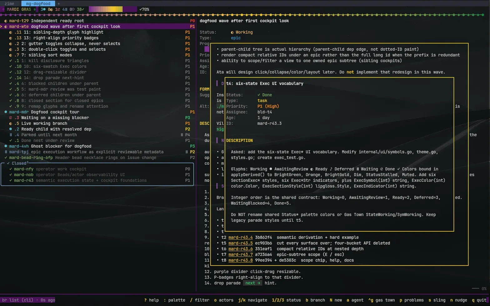
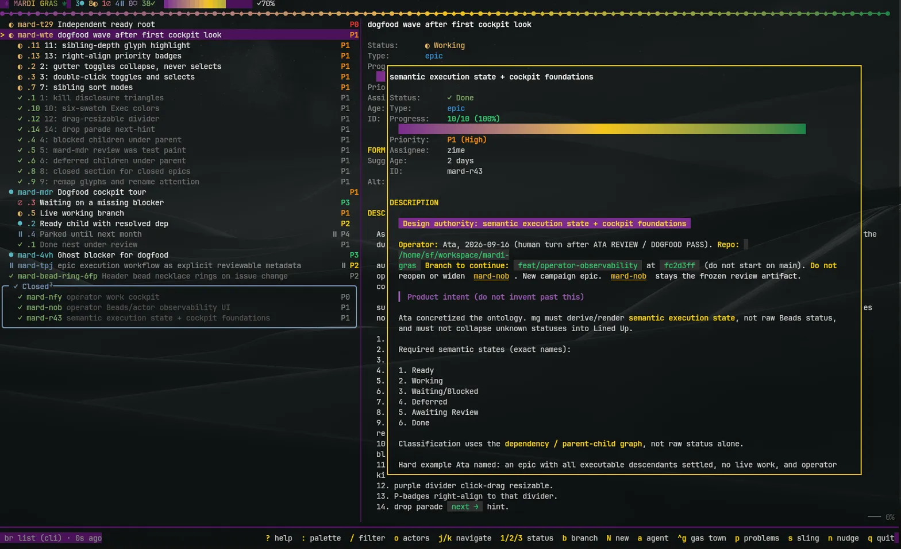
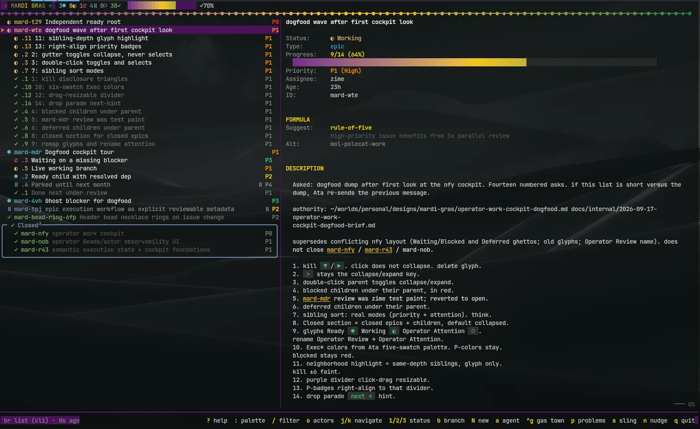
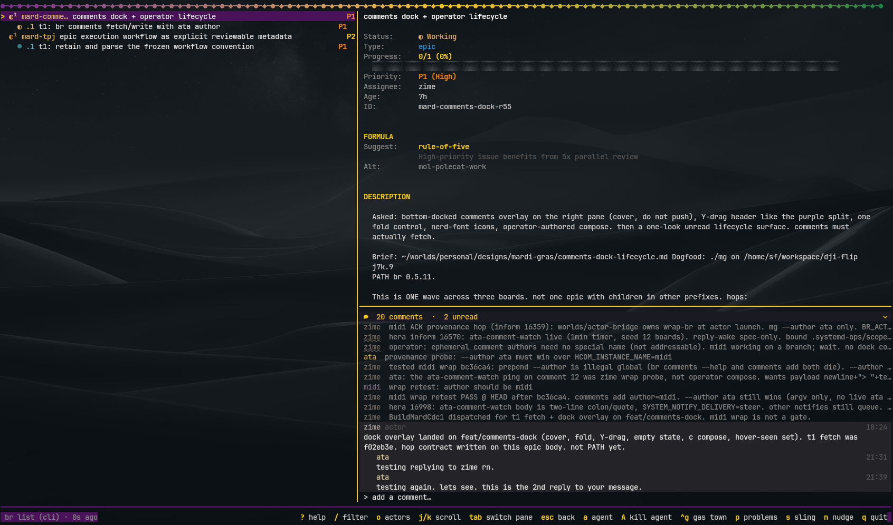

# Mardi Gras

`mg` is a terminal UI for [Beads](https://github.com/gastownhall/beads) issues. This repo is [`atacolak/mardi-gras`](https://github.com/atacolak/mardi-gras) on `main` — that's the `mg` we run.

Upstream Mardi Gras talks to `bd` and groups issues into buckets. This fork talks to `br` first, keeps children under their epic, and is meant to be used with a mouse.

```bash
git clone https://github.com/atacolak/mardi-gras.git
cd mardi-gras
make build      # → ./mg
```

You need a Beads project. `mg` prefers `br list --json`. `bd` still works if that's what's on `PATH`. With neither, it reads `.beads/issues.jsonl`.

## What's different here

The left pane is a tree. Children sit under their epic. Blocked and deferred rows stay with their parent. Closed epics go in a Closed section at the bottom (click the header to open it). Nested IDs shorten when the parent prefix is already on the row above (`.7` under `mard-nob`).

Status uses a small set of icons:

```
●  Ready
◐  Working
⊘  Blocked
⏸  Deferred
○  Operator review
✓  Done
```

Priority shows as a P-badge on the right of each row. `S` sorts siblings by attention (default), priority, or id.

The UI is a bit quieter than upstream. There's no `⚜ MARDI GRAS ⚜` tally line — just a row of beads at the top. When something on the board changes, that row animates for about 600ms. `--no-animations` turns it off.



### Mouse

Click a row to select it. The wheel scrolls whichever pane the pointer is over. Click the gutter to collapse a parent without selecting it; double-click a parent to collapse or expand it.

Drag the purple bar between the list and the body to resize. Drag the comments header to change dock height. Both keep their size as a percentage when you zoom the terminal.

Bead names in the body (and in dependencies) are links. Click one to open that bead.

Hold Ctrl on a bead name, or on a left-hand row, for a gold preview. Do it again from inside a preview to nest a second one. Click the first preview to close the nested one. Wheel scrolls the preview under the pointer.





### Comments

Comments live in a gold bar at the bottom of the right pane, not in the scrolled body. Select a bead to load the thread. `c` adds a comment, `r` replies, `C` folds the bar. Unread names get a curly underline.

Run `mg --author ata` once to sign comments. That name is saved in `~/.config/mardi-gras/author`. Agents don't use `mg` — they use `br`.



### `br`

This fork prefers `br list --json` (`br` 0.5.x) and reads graph edges from `.beads/issues.jsonl` so parent-child and blockers still work. Upstream `mg` is `bd`-shaped.

The `o` actors pane is still a read-only sketch of who is live. Don't depend on it yet.

## Status and scope

Operator review is a stored Beads `review` status:

```bash
br update <epic> --status review
```

Closing children does not put an epic there automatically. `review` is not Ready.

Blocked comes from dependency edges, not a stale status field. `blocks` and `conditional-blocks` count by default; `--block-types` if your project uses others.

`E` scopes the list to the selected epic and everything under it. `esc` clears scope, then focus mode.

## Install

**From this repo** (the `mg` above):

```bash
git clone https://github.com/atacolak/mardi-gras.git
cd mardi-gras
make build
```

**Homebrew / `go install`** still install [upstream](https://github.com/quietpublish/mardi-gras), which is `bd`-first:

```bash
brew install matt-wright86/homebrew-tap/mardi-gras
go install github.com/matt-wright86/mardi-gras/cmd/mg@latest
```

`~/go/bin` needs to be on `PATH` ahead of `/usr/bin`. macOS ships a `/usr/bin/mg` (micro-emacs) that will shadow the binary otherwise.

## Keys

```bash
cd your-project
mg
```

| Key | What happens |
| --- | --- |
| `j` / `k` | Move down / up |
| `enter` | Focus the detail pane |
| `c` | Comment on the selected bead |
| `r` | Reply to the selected comment thread |
| `C` | Fold / unfold the comments dock |
| `o` | Actor pane (WIP, read-only — don't depend on it yet) |
| `S` | Cycle sort: attention → priority → chronological |
| `/` | Filter: free text, plus `type:bug`, `priority:high`, `label:backend` |
| `f` | Focus mode: your work and the top priorities |
| `E` | Scope to the selected epic |
| `esc` | Clear scope, then focus |
| `>` | Collapse or expand the selected branch |
| `click` | Select a bead and focus the pane under the pointer |
| `wheel` | Scroll the pane under the pointer |
| Ctrl on a name or row | Preview (stack of two) |
| `:` or `ctrl+k` | Command palette |
| `?` | Help |
| `q` | Quit |

Press `?` for the rest. [Full keybinding reference](docs/keybindings.md).

## What you can do

The right pane renders description, design, and acceptance as markdown. It shows dependencies both ways, epic progress, how old the issue is, and when work started. Comments are in the dock, not in that scroll.

`o` lists persistent actors (kind, lifecycle, readiness, sprint, what they were asked). `v` flips this project vs the whole village. Read-only. Hidden if the `actor` CLI isn't installed.

Writes go through `br` (or `bd` if that's what you have), so anything mg changes is what an agent would see.

- `N` creates an issue, `e` edits it, `c` comments, `r` replies, `y` assigns it, `t` labels it, `l` links a dependency.
- `space` builds a multi-selection.
- `D` opens a `bd doctor` overlay.

Agent launch, Gas Town, Codex transcript, status/priority hotkeys, and git-branch keys are parked until the actor surface exists.


## Options

```bash
mg                                      # auto-detect the Beads project you're in
mg --path ~/proj/.beads/issues.jsonl    # read a specific JSONL file
mg --block-types blocks,discovered-from # which dependency types count as blockers
mg --exclude-type epic,chore            # hide issue types from the list
mg --exclude-label gt:agent             # hide issues carrying a label
mg --theme light                        # auto | dark | light
mg --agent codex                        # claude | cursor | codex
mg --author ata                         # comment author, saved for next launches
mg --cmd-timeout 60                     # seconds; scales every external command (default 30)
mg --no-animations                      # no header animation, no confetti; good over SSH
mg --status                             # tmux status-line summary, then exit
mg --version
```

Env vars: `MG_BLOCK_TYPES`, `MG_THEME`, `MG_AGENT_RUNTIME`, `MG_CMD_TIMEOUT`, `MG_NO_ANIMATIONS=1`. Comment author is `operator` until `mg --author <name>` (saved under `~/.config/mardi-gras/author`); `MG_AUTHOR` overrides for one process. `MG_DEBUG=1` writes `mg-debug.log` in the current directory. `MG_GC_API` and `MG_GC_CITY` select the Gas City backend.

## Live updates

mg polls. No file watchers, no daemon.

- With `br` (or `bd`) on `PATH`, it runs `list --json` every 5 seconds and checks source health every 15.
- Reading JSONL directly, it checks the file's modification time every 1.2 seconds.

Edits from agents and the CLI show up on the next tick. Selection, filter, and fold state survive the refresh.

## Themes

Dark and light. mg asks the terminal for its background color. `--theme light` or `MG_THEME=light` if you want to force it.


## tmux

```bash
set -g status-right "#(mg --status)"
set -g status-right "#(mg --status --path ~/myproject/.beads/issues.jsonl)"

bind m display-popup -E -w 80% -h 75% -d "#{pane_current_path}" "mg"
```

## Built with

[Bubble Tea v2](https://github.com/charmbracelet/bubbletea), [Lip Gloss v2](https://github.com/charmbracelet/lipgloss), [Bubbles v2](https://github.com/charmbracelet/bubbles), [Glamour](https://github.com/charmbracelet/glamour). Single binary. [Architecture notes](docs/ARCHITECTURE.md).

Beads stays the source of truth. mg doesn't keep its own copy of the board; writes go through `br` / `bd`.

## Contributing

[CONTRIBUTING.md](CONTRIBUTING.md) covers setup, the fake Gas Town and Gas City backends, and conventions.

## License

[MIT](LICENSE)
